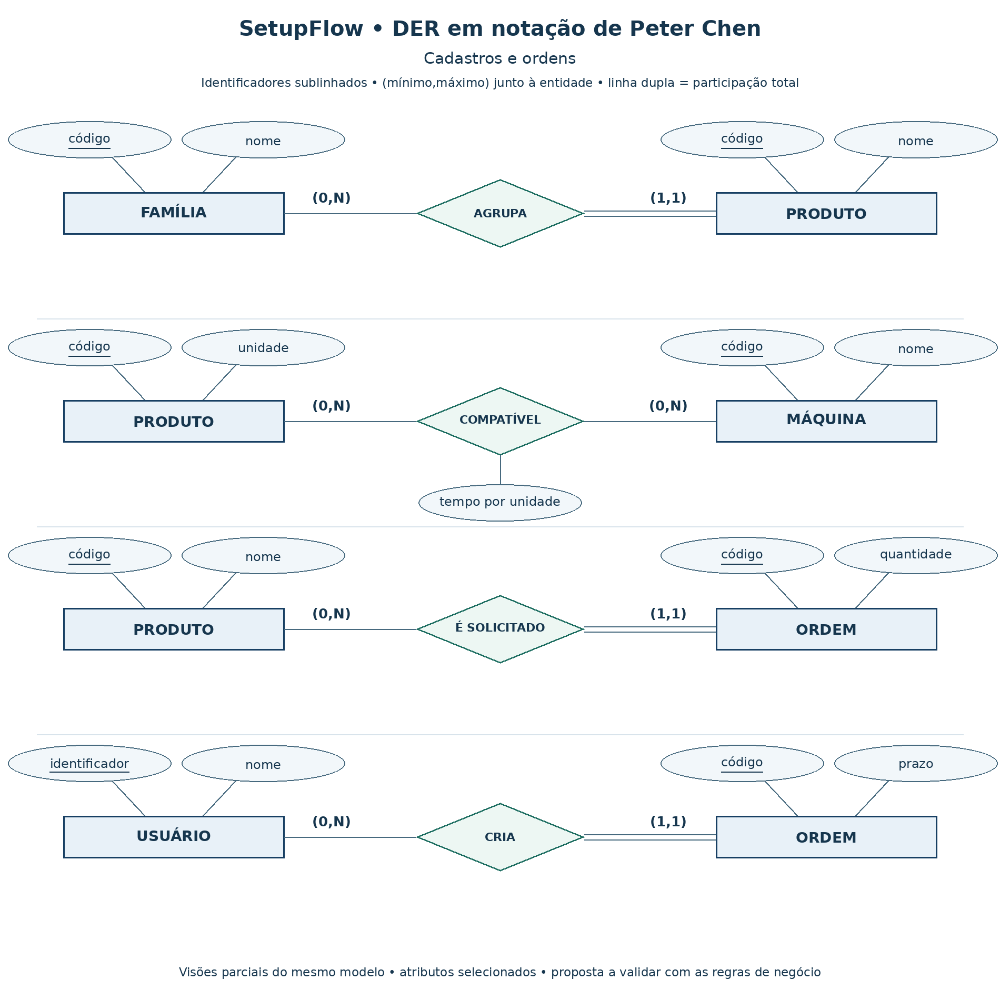
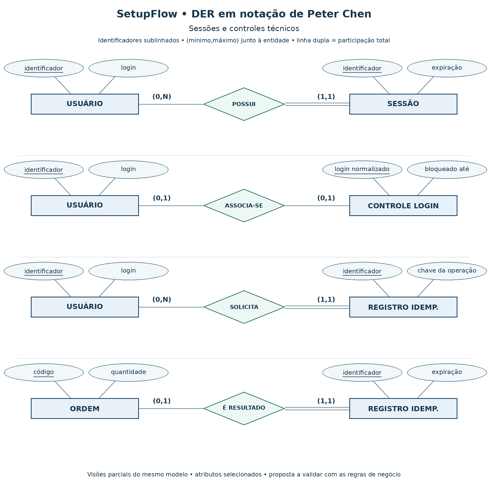
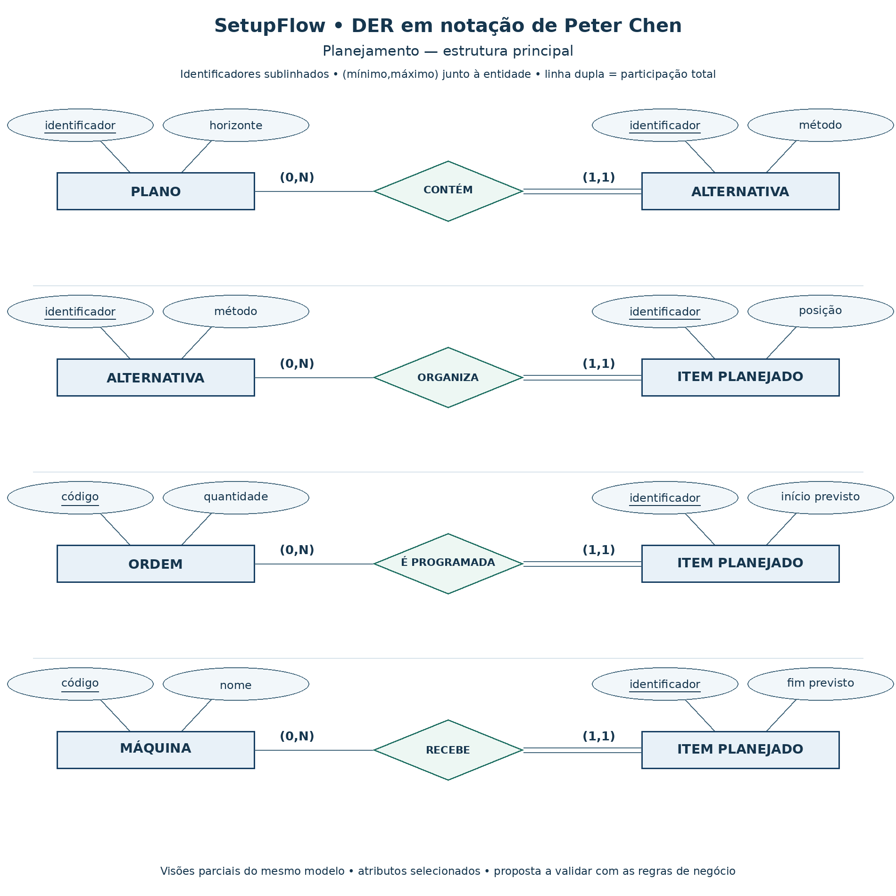
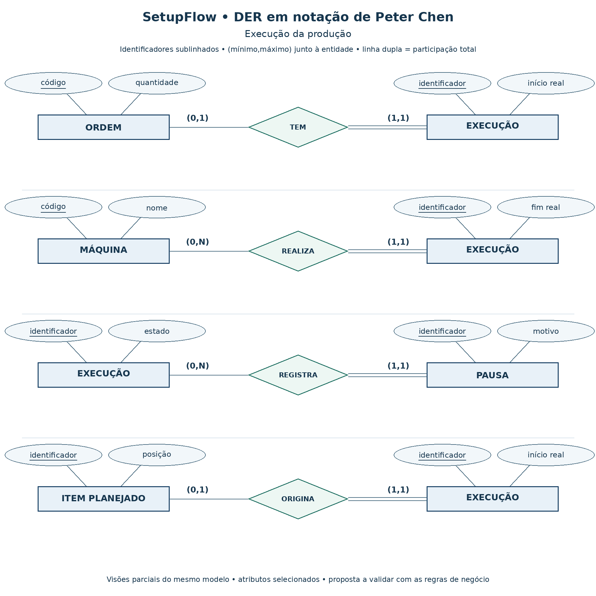

# Modelo de dados do SetupFlow

**Versão:** 0.2 — DER conceitual em Peter Chen e mapeamento relacional  
**Data:** 22/10/2026  
**Estado:** proposta para validação antes das migrações.

## 1. Como ler este documento

A primeira parte apresenta o **Diagrama Entidade-Relacionamento (DER) em notação de Peter Chen**. A segunda mantém o mapeamento para PostgreSQL, com tabelas, tipos, chaves e restrições. Os diagramas anteriores em pé de galinha foram substituídos.

Os diagramas estão divididos por assunto. Uma entidade que aparece em mais de um quadro é a mesma entidade; a repetição evita cruzamentos de linhas. Cada quadro é uma visão parcial de um relacionamento, e não um banco separado. Atributos selecionados aparecem nas imagens; os demais são descritos no catálogo e no mapeamento.

### Notação adotada

| Elemento | Representação |
|---|---|
| Entidade | Retângulo. |
| Relacionamento | Losango ligado às entidades, sem seta. |
| Atributo | Elipse ligada à entidade ou ao relacionamento. |
| Identificador | Nome do atributo sublinhado. |
| Participação parcial | Linha simples; mínimo zero. |
| Participação total | Linha dupla; mínimo um. |
| Cardinalidade | Par `(mínimo,máximo)` colocado junto à entidade à qual se refere. |

Usamos Chen com cardinalidade mínima/máxima. Por exemplo: `(0,N)` ao lado de FAMÍLIA significa que **uma família pode participar de zero a muitas ocorrências de AGRUPA**; `(1,1)` ao lado de PRODUTO significa que cada produto participa exatamente uma vez, pertencendo a uma família. Não interpretar esses pares como rótulos de cardinalidade colocados na extremidade oposta.

Nesta versão não há entidades fracas nem atributos multivalorados nos desenhos. A ausência desses símbolos é intencional. Identificadores conceituais não são chaves estrangeiras: `family_id`, por exemplo, aparece somente no mapeamento relacional.

## 2. Escopo e premissas

A base é a proposta do SetupFlow e as decisões da conversa. O backlog completo não foi recuperado na elaboração original; as premissas continuam sujeitas à validação da equipe.

| Premissa | Consequência no DER |
|---|---|
| Cada produto pertence a uma família. | AGRUPA é 1:N; participação total do produto. |
| Cada ordem solicita um produto. | É SOLICITADO é 1:N; participação total da ordem. |
| Compatibilidade é por produto e máquina. | COMPATÍVEL é N:N e possui o atributo tempo por unidade. Validar se a associação deveria ser por família. |
| Ordens não são divididas em lotes ou operações no MVP. | Uma execução por ordem; um item por ordem em cada alternativa. |
| Setup depende da máquina e das famílias de origem/destino. | TRANSIÇÃO SETUP possui vínculos distintos de origem e destino; A→B pode diferir de B→A. |
| Operador/Supervisor é um perfil único. | Perfil é atributo de USUÁRIO; não são criadas duas entidades de usuário. |
| O MVP não é multiempresa. | Não existe entidade EMPRESA para isolamento de clientes. |

A proposta permite cadastrar família, produto ou máquina antes de suas associações, por isso usa mínimo zero nesses lados. Para planejar uma ordem, as regras do serviço devem exigir os dados e compatibilidades necessários.

## 3. DER — cadastros e ordens

| Relacionamento | Participação da primeira entidade | Participação da segunda entidade |
|---|---|---|
| FAMÍLIA — AGRUPA — PRODUTO | Família `(0,N)` | Produto `(1,1)` |
| PRODUTO — COMPATÍVEL — MÁQUINA | Produto `(0,N)` | Máquina `(0,N)` |
| PRODUTO — É SOLICITADO — ORDEM | Produto `(0,N)` | Ordem `(1,1)` |
| USUÁRIO — CRIA — ORDEM | Usuário `(0,N)` | Ordem `(1,1)` |

**Tempo por unidade pertence ao relacionamento COMPATÍVEL**, pois pode variar conforme o par produto–máquina. No modelo relacional, esse relacionamento origina `product_machines`.

## 4. DER — sessões e controles técnicos

Este recorte usa a mesma notação para entidades técnicas de suporte aos drivers. Ele é separado do domínio produtivo para facilitar a leitura.

| Relacionamento | Participação da primeira entidade | Participação da segunda entidade |
|---|---|---|
| USUÁRIO — POSSUI — SESSÃO | Usuário `(0,N)` | Sessão `(1,1)` |
| USUÁRIO — ASSOCIA-SE — CONTROLE LOGIN | Usuário `(0,1)` | Controle `(0,1)` |
| USUÁRIO — SOLICITA — REGISTRO IDEMP. | Usuário `(0,N)` | Registro `(1,1)` |
| ORDEM — É RESULTADO — REGISTRO IDEMP. | Ordem `(0,1)` | Registro `(1,1)` |

CONTROLE LOGIN pode existir para um login inexistente; por isso o vínculo com USUÁRIO é opcional. REGISTRO IDEMP. significa **registro de idempotência**: conserva o resultado de uma solicitação para que reenvios não criem novas ordens. O lado da ordem é opcional porque o registro pode expirar após a janela garantida, enquanto a ordem permanece.

## 5. DER — planejamento

| Relacionamento | Participação da primeira entidade | Participação da segunda entidade |
|---|---|---|
| PLANO — CONTÉM — ALTERNATIVA | Plano `(0,N)` | Alternativa `(1,1)` |
| ALTERNATIVA — ORGANIZA — ITEM PLANEJADO | Alternativa `(0,N)` | Item `(1,1)` |
| ORDEM — É PROGRAMADA — ITEM PLANEJADO | Ordem `(0,N)` | Item `(1,1)` |
| MÁQUINA — RECEBE — ITEM PLANEJADO | Máquina `(0,N)` | Item `(1,1)` |

ITEM PLANEJADO tem identidade própria e atributos como posição, início e fim previstos. Cada item pertence a uma alternativa, representa uma ordem e indica uma máquina. Uma ordem pode aparecer em alternativas diferentes, mas somente uma vez dentro da mesma alternativa.

Plano e alternativa podem começar vazios durante sua preparação. A aprovação deve exigir conteúdo válido. O desenho não autoriza aprovar uma alternativa vazia.

### Relacionamentos complementares previstos

Para evitar uma imagem excessivamente grande, os vínculos abaixo são especificados em tabela. **Eles ainda não estão desenhados nas imagens** e devem ser acrescentados ao DER completo quando suas funcionalidades forem detalhadas.

| Relacionamento | Participações propostas | Observação |
|---|---|---|
| MÁQUINA — TEM — TRANSIÇÃO SETUP | Máquina `(0,N)`; transição `(1,1)` | A transição pertence a uma máquina. |
| FAMÍLIA — É ORIGEM — TRANSIÇÃO SETUP | Família `(0,N)`; transição `(1,1)` | Papel de origem. |
| FAMÍLIA — É DESTINO — TRANSIÇÃO SETUP | Família `(0,N)`; transição `(1,1)` | Papel de destino; não confundir com origem. |
| MÁQUINA — TEM — INDISPONIBILIDADE | Máquina `(0,N)`; intervalo `(1,1)` | Se exigido pelo backlog. |
| USUÁRIO — ELABORA — PLANO | Usuário `(0,N)`; plano `(1,1)` | Autor do plano. |
| PLANO novo — SUBSTITUI — PLANO anterior | Novo `(0,1)`; anterior `(0,N)` | Autorrelacionamento com papéis; apenas um sucessor pode permanecer vigente segundo a regra de aprovação. |
| USUÁRIO — REGISTRA — APROVAÇÃO | Usuário `(0,N)`; aprovação `(1,1)` | Autor do aceite. |
| PLANO — RECEBE — APROVAÇÃO | Plano `(0,1)`; aprovação `(1,1)` | Uma aprovação por revisão. |
| ALTERNATIVA — É ESCOLHIDA — APROVAÇÃO | Alternativa `(0,1)`; aprovação `(1,1)` | A alternativa deve pertencer ao plano aprovado. |
| ORDEM — ESTÁ ALOCADA EM — ITEM PLANEJADO | Ordem `(0,1)`; item `(0,1)` | Relacionamento adicional de alocação vigente, diferente do vínculo histórico É PROGRAMADA. |

Restrições como a alternativa pertencer ao plano aprovado e uma ordem não ocupar dois planos vigentes não são expressas somente pelas cardinalidades; precisam das regras descritas no mapeamento.

## 6. DER — execução

| Relacionamento | Participação da primeira entidade | Participação da segunda entidade |
|---|---|---|
| ORDEM — TEM — EXECUÇÃO | Ordem `(0,1)` | Execução `(1,1)` |
| MÁQUINA — REALIZA — EXECUÇÃO | Máquina `(0,N)` | Execução `(1,1)` |
| EXECUÇÃO — REGISTRA — PAUSA | Execução `(0,N)` | Pausa `(1,1)` |
| ITEM PLANEJADO — ORIGINA — EXECUÇÃO | Item `(0,1)` | Execução `(1,1)` |

O vínculo obrigatório com ITEM PLANEJADO pressupõe execução iniciada a partir de uma sequência aprovada. Se o backlog permitir iniciar sem planejamento, essa participação precisa ser revista. A máquina e a ordem da execução devem corresponder ao item de origem.

Vínculos de autoria complementares: USUÁRIO — INICIA — EXECUÇÃO e USUÁRIO — REGISTRA — PAUSA, ambos com usuário `(0,N)` e ocorrência `(1,1)`. Para auditoria, USUÁRIO — REALIZA — EVENTO AUDITORIA tem usuário `(0,N)` e evento `(0,1)`, permitindo eventos do sistema.

## 7. Catálogo de atributos conceituais

Identificadores dos desenhos estão sublinhados. Na tabela abaixo, eles aparecem em coluna própria. Não se incluem FKs como atributos conceituais: os vínculos são representados pelos relacionamentos.

| Entidade ou relacionamento | Identificador proposto | Outros atributos principais |
|---|---|---|
| USUÁRIO | identificador | nome, login, perfil, ativo |
| FAMÍLIA | código | nome, descrição, ativa |
| PRODUTO | código | nome, unidade, ativo |
| MÁQUINA | código | nome, descrição, ativa |
| ORDEM | código | quantidade, prazo, prioridade, estado |
| COMPATÍVEL (relacionamento) | par produto–máquina | tempo por unidade, ativo |
| SESSÃO | identificador | criação, expiração, último uso, revogação |
| CONTROLE LOGIN | login normalizado | tentativas falhas, início da janela, bloqueado até |
| REGISTRO IDEMPOTÊNCIA | identificador | chave da operação, tipo de operação, criação, expiração |
| TRANSIÇÃO SETUP | identificador | duração |
| INDISPONIBILIDADE | identificador | início, fim, motivo |
| PLANO | identificador | nome, horizonte, revisão, estado |
| ALTERNATIVA | identificador | nome, método, versão do algoritmo, métricas |
| ITEM PLANEJADO | identificador | posição, início/fim previstos, tempo de setup, tempo de processamento |
| APROVAÇÃO | plano (identificação dependente) | instante de aprovação |
| EXECUÇÃO | identificador | início, fim, estado |
| PAUSA | identificador | início, fim, motivo |
| EVENTO AUDITORIA | identificador | ação, tipo de objeto, objeto, instante, detalhes |

APROVAÇÃO é identificada pelo plano no mapeamento atual. Se for desenhada como entidade dependente sem identificador próprio, usar entidade fraca e relacionamento identificador em Chen. Ela não aparece como entidade forte nas imagens desta entrega.

Código é identificador de negócio dos cadastros e das ordens. Na implementação, essas entidades também recebem `id` UUID como chave técnica, preservando o código como único. Hash de senha, hash de token, versão concorrente e detalhes de resposta são elementos técnicos documentados a seguir.

## 8. Mapeamento para PostgreSQL

Esta parte é **relacional**, não uma continuação da notação gráfica de Chen. Os nomes das tabelas permanecem alinhados ao backend.

- Entidade forte → tabela com chave primária.
- Relacionamento 1:N → FK no lado N, obrigatória quando a participação desse lado for total.
- Relacionamento N:N → tabela associativa com as duas FKs e os atributos do relacionamento.
- Relacionamento 1:1 → FK com unicidade e nulabilidade conforme a participação, ou tabela própria quando necessário.
- Identificadores de negócio → constraints de unicidade, mesmo quando a PK usa UUID.

Por exemplo, FAMÍLIA — AGRUPA — PRODUTO é convertido em `products.family_id`; COMPATÍVEL é convertido em `product_machines`, contendo o tempo por unidade.

### 2. Convenções

- Tabelas e colunas em inglês e `snake_case`, alinhadas aos arquivos Python.
- `id`: UUID, chave primária, salvo quando indicada chave composta.
- Datas de eventos: `timestamptz`; armazenar instantes e converter para o fuso da interface.
- Quantidades: `numeric(14,3)` positivo; validar se o domínio exige somente inteiros.
- Durações estimadas: segundos, com `numeric(14,3)` quando houver frações.
- Entidades mutáveis: `created_at`, `updated_at` e `version bigint NOT NULL DEFAULT 1`.
- Cadastros referenciados por histórico devem ser inativados, não apagados em cascata.
- Códigos e login normalizados antes da gravação, com unicidade no banco.
- Estados e perfis devem ter valores controlados por constraint ou enum; sua lista definitiva depende dos critérios de aceite.

### 3. Tabelas — base funcional

#### `users` — usuários

| Campo | Tipo | Regra |
|---|---|---|
| `id` | uuid | PK. |
| `name` | varchar(150) | Obrigatório. |
| `login` | varchar(254) | Obrigatório, normalizado e único. Validar uso de e-mail como login. |
| `password_hash` | text | Hash de senha; nunca retornar na API. |
| `role` | varchar(30) | Proposta: `planner` ou `operator_supervisor`. |
| `is_active` | boolean | Controla acesso sem excluir histórico. |
| `created_at`, `updated_at`, `version` | campos comuns | Rastreabilidade e concorrência. |

#### `machines` — máquinas

| Campo | Tipo | Regra |
|---|---|---|
| `id` | uuid | PK. |
| `code` | varchar(50) | Único e obrigatório. |
| `name` | varchar(150) | Obrigatório. |
| `description` | text | Opcional. |
| `is_active` | boolean | Máquina inativa não recebe novos planejamentos. |
| `created_at`, `updated_at`, `version` | campos comuns | Rastreabilidade e concorrência. |

Disponibilidade não deve ser inferida apenas de `is_active`: manutenção e indisponibilidade temporal pertencem a intervalos próprios, caso exigidos pelo backlog.

#### `families` — famílias de produtos

| Campo | Tipo | Regra |
|---|---|---|
| `id` | uuid | PK. |
| `code` | varchar(50) | Único e obrigatório. |
| `name` | varchar(150) | Obrigatório. |
| `description` | text | Opcional. |
| `is_active` | boolean | Preserva referências históricas. |
| `created_at`, `updated_at`, `version` | campos comuns | Rastreabilidade e concorrência. |

#### `products` — produtos

| Campo | Tipo | Regra |
|---|---|---|
| `id` | uuid | PK. |
| `family_id` | uuid | FK para `families`, obrigatória. |
| `code` | varchar(50) | Único e obrigatório. |
| `name` | varchar(150) | Obrigatório. |
| `unit` | varchar(20) | Unidade da quantidade, por exemplo `un` ou `kg`; validar domínio. |
| `is_active` | boolean | Impede uso em novos cadastros conforme regra acordada. |
| `created_at`, `updated_at`, `version` | campos comuns | Rastreabilidade e concorrência. |

#### `product_machines` — compatibilidade e tempo de processamento

| Campo | Tipo | Regra |
|---|---|---|
| `product_id` | uuid | FK para `products`; parte da PK composta. |
| `machine_id` | uuid | FK para `machines`; parte da PK composta. |
| `processing_seconds_per_unit` | numeric(14,3) | Maior que zero; proposto como entrada da estimativa de duração. |
| `is_active` | boolean | Controla a disponibilidade da associação. |
| `created_at`, `updated_at`, `version` | campos comuns | Rastreabilidade e concorrência. |

A fórmula inicial é `duração = quantidade × tempo por unidade`. Confirmar se os dados de entrada do backlog usam velocidade, duração por lote ou outra medida antes de adotar esse campo.

#### `production_orders` — ordens de produção

| Campo | Tipo | Regra |
|---|---|---|
| `id` | uuid | PK. |
| `code` | varchar(50) | Identificador único de negócio. |
| `product_id` | uuid | FK para `products`, obrigatória. |
| `quantity` | numeric(14,3) | Maior que zero. |
| `due_at` | timestamptz | Prazo de conclusão; validar obrigatoriedade. |
| `priority` | smallint | Proposta: 1 a 5, sendo 1 a maior prioridade; confirmar escala. |
| `status` | varchar(30) | Proposta: `pending`, `in_progress`, `completed`, `cancelled`. |
| `created_by` | uuid | FK para `users`, obrigatória. |
| `created_at`, `updated_at`, `version` | campos comuns | Rastreabilidade e concorrência. |

Não criar uma restrição única sobre produto, quantidade e prazo: duas ordens legítimas podem compartilhar esses valores. A prevenção de reenvios depende da chave de idempotência.

O vínculo com planejamento é representado pelos itens e pela aprovação da sequência. Evitar duplicar essa informação em um estado `planned` sem uma regra explícita de sincronização.

### 4. Autenticação e idempotência — base da R1

#### `auth_sessions`

| Campo | Tipo | Regra |
|---|---|---|
| `id` | uuid | PK. |
| `user_id` | uuid | FK obrigatória para `users`. |
| `token_hash` | text | Único; hash do token aleatório enviado ao navegador. |
| `created_at` | timestamptz | Início da sessão. |
| `expires_at` | timestamptz | Expiração absoluta obrigatória. |
| `last_seen_at` | timestamptz | Suporte a timeout por inatividade se exigido pelo Driver06. |
| `revoked_at` | timestamptz | Nulo enquanto não revogada. |

Uma sessão só autoriza acesso se o usuário estiver ativo e todos os limites de expiração/revogação forem respeitados. Atualizar `last_seen_at` não deve eliminar a expiração absoluta. Validar no Driver06 os limites exatos e a política de sessões simultâneas.

#### `login_guards`

| Campo | Tipo | Regra |
|---|---|---|
| `normalized_login` | varchar(254) | PK; permite controlar tentativas mesmo para login inexistente. |
| `user_id` | uuid | FK opcional para `users`, única quando preenchida. |
| `failed_attempts` | integer | Maior ou igual a zero. |
| `window_started_at` | timestamptz | Início da janela de contagem. |
| `blocked_until` | timestamptz | Opcional; representa o bloqueio em vigor. |
| `updated_at` | timestamptz | Última atualização. |

Criar/atualizar o controle atomicamente, com unicidade e bloqueio de linha ou operação equivalente. Contadores por IP, se necessários, são complementares e precisam de regra própria. Validar no Driver05 limiar, janela, duração e condições de reset. Aplicar retenção a registros de logins inexistentes para evitar crescimento ilimitado.

Na árvore anterior foi sugerido `login_attempt.py`; este modelo propõe `login_guard.py` para representar o estado agregado. Um log de cada tentativa pode ser adicionado separadamente se houver requisito de auditoria.

#### `idempotency_records`

Escopo inicial: cadastro de ordem de produção. Uma generalização para outros recursos exige um contrato explícito.

| Campo | Tipo | Regra |
|---|---|---|
| `id` | uuid | PK. |
| `user_id` | uuid | FK obrigatória para `users`. |
| `operation` | varchar(80) | Tipo de operação; inicialmente `create_production_order`. |
| `idempotency_key` | varchar(128) | Chave recebida do cliente. |
| `request_hash` | text | Hash dos dados validados e normalizados da solicitação. |
| `production_order_id` | uuid | FK obrigatória e única para a ordem criada. |
| `response_status` | smallint | Status HTTP do resultado persistido. |
| `response_body` | jsonb | Resposta original, sem segredos, para repetição consistente. |
| `created_at` | timestamptz | Registro da operação. |
| `expires_at` | timestamptz | Fim da retenção mínima definida no Driver02. |

Constraint: `UNIQUE(user_id, operation, idempotency_key)`.

A ordem e o registro de idempotência são confirmados na **mesma transação**. Em corrida entre duas solicitações, a perdedora deve desfazer integralmente sua tentativa e consultar o resultado confirmado. Nenhuma resposta de sucesso deve ser emitida antes do commit. A exclusão de chaves expiradas não pode ocorrer antes da janela garantida.

### 5. Evolução — planejamento e setups

As entidades desta seção são previstas para as funcionalidades posteriores à base de cadastros. A release exata deve seguir o plano aprovado pela equipe.

| Entidade | Campos principais propostos | Regras |
|---|---|---|
| `setup_transitions` | `id`, `machine_id` FK, `from_family_id` FK, `to_family_id` FK, `duration_seconds`, `version` | Único por máquina/origem/destino; duração ≥ 0. Não presumir simetria nem setup zero quando faltar configuração. |
| `machine_unavailability` | `id`, `machine_id` FK, `starts_at`, `ends_at`, `reason` | Intervalo final posterior ao inicial; criar se a indisponibilidade temporal for exigida. |
| `production_plans` | `id`, `name`, `horizon_start`, `horizon_end`, `revision`, `supersedes_plan_id` FK opcional, `status`, `created_by` FK, `version` | Horizonte válido; revisão preserva o plano anterior. |
| `plan_alternatives` | `id`, `plan_id` FK, `name`, `method`, `algorithm_version`, `input_snapshot` jsonb, `metrics` jsonb, `created_at` | Alternativas manuais e geradas; snapshot guarda entradas e versões usadas. |
| `plan_items` | `id`, `alternative_id` FK, `order_id` FK, `machine_id` FK, `position`, `planned_start`, `planned_end`, `setup_seconds`, `processing_seconds` | Único por `(alternative_id, order_id)` e por `(alternative_id, machine_id, position)`; tempos válidos. |
| `plan_approvals` | `plan_id` PK/FK, `alternative_id`, `approved_by` FK, `approved_at` | Uma alternativa aprovada por revisão do plano; FK composta garante que a alternativa pertence ao plano. |
| `active_order_allocations` | `order_id` PK/FK, `plan_item_id` FK única | Uma alocação ativa por ordem entre todos os planos aprovados. |

Para a FK composta de aprovação, definir `UNIQUE(plan_id, id)` em `plan_alternatives` e fazer `(plan_id, alternative_id)` de `plan_approvals` referenciar esse par.

Ao aprovar ou replanejar, atualizar aprovação, alocações ativas e substituição do plano em uma única transação. A unicidade de `active_order_allocations.order_id` evita que dois planos concorrentes aprovem a mesma ordem. A relação entre alocação, item e ordem também deve ser garantida por FK composta ou regra transacional equivalente, não apenas pela interface.

Conflitos de ocupação da mesma máquina exigem serialização consistente da aprovação por máquina (por exemplo, bloqueios transacionais adquiridos em ordem estável) e revalidação de intervalos. A unicidade da ordem, sozinha, não impede sobreposição de ordens diferentes.

Ficam pendentes: estado inicial da máquina para o primeiro setup, setups por produto, significado de início/fim em relação ao setup, horizonte por turno, calendário de trabalho e critérios de desempate. Essas definições afetam o cálculo do prazo e devem integrar os testes do algoritmo.

### 6. Evolução — execução e indicadores

| Entidade | Campos principais propostos | Regras |
|---|---|---|
| `executions` | `id`, `order_id` FK única, `machine_id` FK, `source_plan_item_id` FK, `started_by` FK, `started_at`, `finished_at`, `status`, `version` | Uma execução por ordem no MVP sem divisão de lote; conclusão não antecede início; preservar vínculo ao planejamento usado no início. |
| `execution_pauses` | `id`, `execution_id` FK, `started_at`, `ended_at`, `reason`, `created_by` FK | No máximo uma pausa aberta por execução; intervalos não podem se sobrepor. |
| `audit_events` | `id`, `actor_user_id` FK opcional, `action`, `entity_type`, `entity_id`, `occurred_at`, `request_id`, `details` jsonb | Registro de ações relevantes; não incluir senhas, cookies ou tokens. |

Proteger início, pausa, retomada e conclusão com transação e controle de concorrência. Ao concluir uma execução, definir o tratamento de uma pausa ainda aberta. O início deve validar a alocação aprovada e a ocupação da máquina.

Se o tempo real descontar pausas, calcular `fim − início − soma das pausas válidas`, evitando dupla subtração por intervalos sobrepostos. Não interpretar pausas de produção como setup sem regra explícita.

Indicadores iniciais podem ser consultas sobre planos e execuções. Não é necessário criar uma tabela genérica de indicadores antes de definir as métricas e sua frequência de atualização.

### 7. Integridade, concorrência e índices

| Necessidade | Implementação proposta |
|---|---|
| Atualizações concorrentes | `UPDATE ... WHERE id = :id AND version = :expected_version`, incrementando `version` na mesma instrução; zero linhas implica conflito. |
| Operações com várias gravações | Serviço controla uma transação; repositórios usam a mesma sessão e não confirmam isoladamente. |
| Preservação histórica | FKs com exclusão restrita nos cadastros usados; inativação como regra inicial. |
| Consulta de ordens | Índice proposto em `(status, due_at)`; validar com consultas reais. |
| Sessões | Índice único em `token_hash`; índices em `user_id` e `expires_at` conforme consultas e limpeza. |
| Idempotência | Índice único composto da chave; índice em `expires_at` para limpeza. |
| Sequência aprovada | Índice de itens por `(alternative_id, machine_id, position)` e consulta pela aprovação. |
| Execuções e pausas | Índices por `order_id` e `execution_id`; índice único parcial para pausa aberta. |

Não criar índices indiscriminadamente: medir consultas com volumes representativos e verificar planos de execução. A paginação, a ordenação estável e a ausência de consultas repetidas por item também fazem parte do desempenho.

### 8. Ordem de implementação sugerida

1. Configurar Alembic, convenções e banco de teste.
2. Criar usuários, sessões e controle de login.
3. Criar famílias, máquinas, produtos e associação de compatibilidade, após validar suas cardinalidades.
4. Criar ordens e idempotência; testar integridade e atualizações concorrentes.
5. Evoluir setups, planos, alternativas, aprovação e alocações.
6. Evoluir execução, pausas e indicadores conforme as US.

Cada etapa precisa de migrações revisadas e testes sobre PostgreSQL. Os testes dos drivers devem incluir falhas e concorrência real, além dos fluxos de sucesso. A aprovação deste documento não substitui o aceite das US nem as evidências do DoD.

### 9. Referências

- Proposta do SetupFlow, versão 1.0, de 09/10/2026: escopo macro, perfis e stack.
- Decisões de organização e drivers discutidas na conversa do projeto.
- [Arquitetura do sistema](arquitetura.md).

Este arquivo é uma proposta lógica. Limites dos drivers, regras de acesso e detalhes de negócio devem ser confrontados com as especificações aprovadas antes das migrações definitivas.
