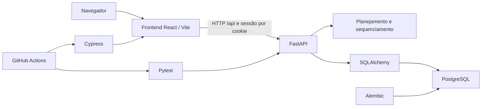
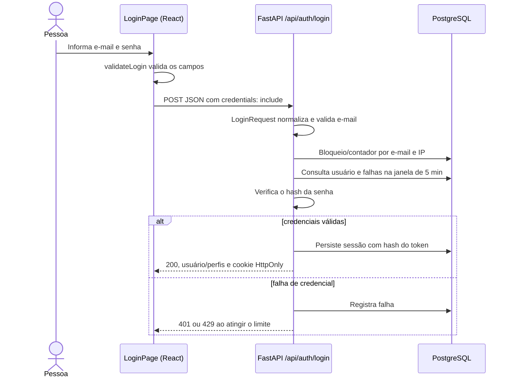

# Mapa visual do SetupFlow

O repositório reúne a aplicação web, a API, o esquema PostgreSQL, os testes e as evidências de entrega. [Estado das entregas e DoD](status-projeto.md)

## Visão rápida

## Organização do repositório

| Caminho | Conteúdo |
| --- | --- |
| `.github/workflows/ci.yml` | Pytest com PostgreSQL, lint, build e Cypress em Chrome e Electron. |
| `backend/app/api/` | Operações HTTP em `routes/` e dependências de sessão e autorização em `deps.py`. |
| `backend/app/schemas/` · `backend/app/models/` | Contratos Pydantic e modelos ORM. |
| `backend/app/core/` · `backend/app/db/` | Configuração, hashes, tokens, base ORM e conexão com o PostgreSQL. |
| `backend/app/services/` | Sequenciamento e distribuição de ordens por máquina. |
| `backend/migrations/versions/` | Migrações de autenticação, cadastros, ordens e planejamento até a aprovação. |
| `backend/scripts/` | Criação de usuário inicial e preparação do banco isolado do Cypress. |
| `backend/testes/integration/` · `backend/testes/unit/` | Suítes de histórias, drivers, sequenciamento e preparação dos dados. |
| `frontend/src/features/` | Autenticação, usuários, cadastros, ordens, tempos e matriz de setup e planejamento. |
| `frontend/src/components/layout/` · `frontend/src/lib/` | Navegação por perfil e cliente HTTP compartilhado. |
| `frontend/cypress/` | Features Gherkin, passos de teste e configuração da suíte de aceitação. |
| `docs/arquitetura/` | Arquitetura e modelo de dados implementado e planejado. |
| `docs/qualidade/` | Planos, relatórios de QA, auditoria e evidências de reteste. |
| `docs/releases/` | Notas, revisão de sprint e resultados de teste por release. |

## Caminho de um login

## Como os testes se conectam

O Pytest usa o `TestClient` para instanciar a API ASGI com um PostgreSQL de teste. A fixture exige `TEST_DATABASE_URL` com nome terminado em `_test` e aplica as migrações antes de preparar os dados. O Cypress integrado usa frontend, API e outro PostgreSQL, com nome terminado em `_e2e_test`. Na CI, os jobs criam bancos isolados e publicam os resultados. [Guia do backend](../backend/README.md#testes-de-integração-da-us01) · [Guia Cypress](../frontend/cypress/README.md)
