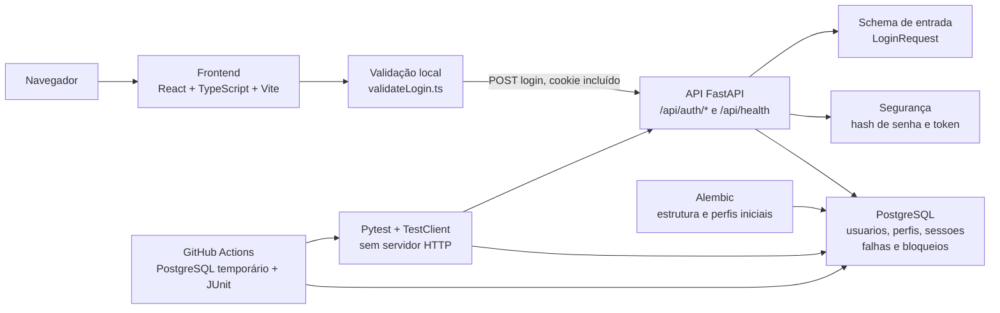
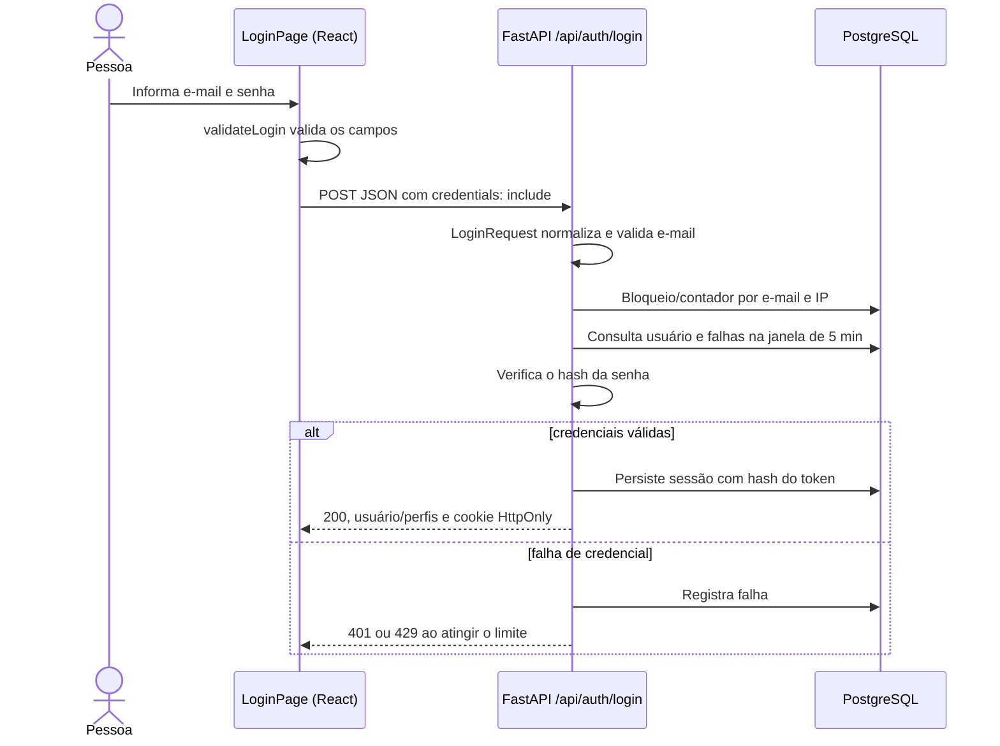

# Mapa visual do SetupFlow

Este documento descreve a estrutura **existente** do repositório e o papel de cada pasta e arquivo versionado. A arquitetura funcional ainda está em evolução; pastas ou arquivos previstos para releases futuras não aparecem como implementados neste mapa.

## Visão rápida



## Árvore do repositório

Arquivos locais ignorados pelo Git, dependências instaladas e resultados gerados durante os testes — por exemplo `.env`, `.venv/`, `node_modules/`, caches e `junit*.xml` — não são listados como código versionado.

```text
Gerencia-Projeto-2026.2/
├── .github/                                  Configuração de colaboração e CI
│   ├── ISSUE_TEMPLATE/
│   │   ├── bug_report.md                    Formulário de relato de defeito
│   │   └── user_story.md                    Formulário de história de usuário
│   ├── workflows/
│   │   └── ci.yml                           Pytest em PR com PostgreSQL e artefato JUnit
│   └── pull_request_template.md             Estrutura para descrição de PR
├── backend/                                  API, persistência e testes Python
│   ├── app/
│   │   ├── __init__.py                      Marca o pacote Python da aplicação
│   │   ├── main.py                          Cria FastAPI, CORS e registra rotas
│   │   ├── api/
│   │   │   ├── deps.py                      Fornece a sessão SQLAlchemy às rotas
│   │   │   └── routes/
│   │   │       ├── auth.py                  Login, sessão, /me, logout e bloqueio
│   │   │       └── health.py                Endpoint GET /api/health
│   │   ├── core/
│   │   │   ├── config.py                    Lê configurações e variáveis DB_*
│   │   │   └── security.py                  Hash/verificação de senha e token de sessão
│   │   ├── db/
│   │   │   ├── base.py                      Base declarativa dos modelos ORM
│   │   │   └── session.py                   Engine PostgreSQL e fábrica de sessões
│   │   ├── scheduling/                      Reservado para sequenciamento; ainda vazio
│   │   ├── services/                        Reservado para serviços; ainda vazio
│   │   ├── models/
│   │   │   ├── __init__.py                  Registra modelos no metadata do ORM
│   │   │   ├── controle_tentativas_login.py Contador de bloqueio por e-mail e IP
│   │   │   ├── falha_login.py               Falhas individuais com data e hora
│   │   │   ├── perfil.py                    Perfil de acesso
│   │   │   ├── sessao.py                    Sessão persistida, expiração e invalidação
│   │   │   ├── usuario.py                   Usuário e hash de senha
│   │   │   └── usuario_perfil.py            Associação entre usuários e perfis
│   │   └── schemas/
│   │       └── auth.py                      Validação e normalização dos dados de login
│   ├── migrations/
│   │   ├── versions/
│   │   │   ├── 8c4926160d84_cria_esquema_de_autenticacao.py
│   │   │   │                                  Cria tabelas, relações e índices de autenticação
│   │   │   └── 4ba7b334799a_insere_perfis_de_acesso.py
│   │   │                                      Insere PLANEJADOR e OPERADOR
│   │   ├── env.py                           Configuração Alembic e metadata dos modelos
│   │   ├── README                            Arquivo de referência gerado pelo Alembic
│   │   └── script.py.mako                   Template de novas migrations
│   ├── scripts/
│   │   ├── __init__.py                      Marca o pacote de scripts
│   │   └── create_initial_user.py           Cria usuário local com senha em hash
│   ├── testes/
│   │   ├── integration/
│   │       ├── conftest.py                  Protege TEST_DATABASE_URL, aplica migrations e prepara dados
│   │       ├── README-US01.md               Instruções das suítes de autenticação
│   │       ├── test_us01_auth.py            Testes básicos de login e sessão
│   │       └── drivers/
│   │           └── test_driver05_rate_limiting.py
│   │                                          Bloqueio, 20 ciclos, isolamento e tempo simulado
│   │   └── unit/                            Reservado para testes unitários; ainda vazio
│   ├── .env.example                         Exemplo de configuração local sem credenciais reais
│   ├── alembic.ini                          Configuração principal do Alembic
│   ├── README.md                            Instalação, banco, execução e testes backend
│   └── requirements.txt                     Dependências Python fixadas
├── docs/
│   ├── arquitetura/
│   │   ├── diagramas/
│   │   │   ├── chen-cadastros.png           Diagrama conceitual de cadastros
│   │   │   ├── chen-execucao.png            Diagrama conceitual de execução
│   │   │   ├── chen-planejamento.png        Diagrama conceitual de planejamento
│   │   │   └── chen-seguranca.png           Diagrama conceitual de segurança
│   │   ├── Arquitetura-SetupFlow.png        Visão gráfica da arquitetura proposta
│   │   ├── arquitetura.md                   Decisões e proposta arquitetural
│   │   ├── mini-mundo.md                    Contexto e regras conceituais do domínio
│   │   └── modelo-de-dados.md               Modelo de dados conceitual
│   ├── planejamento/                        Planejamento de releases, sprints e US
│   ├── qualidade/                           Planos, drivers e critérios de qualidade
│   ├── releases/                            Registros e escopo das releases
│   ├── riscos/                               Avaliação e acompanhamento de riscos
│   ├── setup/                                Guias de configuração do ambiente
│   ├── sprints/                              Registros de planejamento e revisão
│   ├── estrutura-projeto.md                 Este mapa visual e inventário do código
│   └── padroes_de_commit                    Convenção de mensagens de commit
├── frontend/                                 Interface web
│   ├── public/
│   │   ├── images/
│   │   │   ├── setupflow-logo-completo.png  Logo completa usada na tela de login
│   │   │   ├── setupflow-simbolo.png        Símbolo da marca
│   │   │   └── setupflow-wordmark.png       Nome gráfico da marca
│   │   ├── favicon.svg                      Ícone da aba do navegador
│   │   └── icons.svg                        Conjunto de ícones estáticos
│   ├── src/
│   │   ├── assets/
│   │   │   ├── hero.png                     Imagem de recurso do Vite
│   │   │   ├── react.svg                    Recurso padrão do React
│   │   │   └── vite.svg                     Recurso padrão do Vite
│   │   ├── features/auth/
│   │   │   ├── pages/LoginPage.tsx           Tela e envio do login à API
│   │   │   └── validation/validateLogin.ts   Validação local de e-mail e senha
│   │   ├── App.css                          Estilos do componente raiz
│   │   ├── App.tsx                          Componente raiz; exibe LoginPage
│   │   ├── index.css                        Estilos globais e Tailwind
│   │   └── main.tsx                         Monta React no elemento root do HTML
│   ├── .gitignore                           Ignora artefatos locais do frontend
│   ├── eslint.config.js                     Regras de lint TypeScript/React
│   ├── index.html                           Documento HTML de entrada do Vite
│   ├── package.json                         Dependências e scripts npm
│   ├── package-lock.json                    Versões resolvidas das dependências
│   ├── README.MD                            Instruções do frontend
│   ├── tsconfig.json                        Configuração base do TypeScript
│   ├── tsconfig.app.json                    Configuração TypeScript da aplicação
│   ├── tsconfig.node.json                   Configuração TypeScript para ferramentas
│   └── vite.config.ts                       Plugins e servidor/build do Vite
├── .gitignore                                Arquivos locais e gerados ignorados pelo Git
├── LICENSE                                   Licença do repositório
└── README.md                                 Apresentação do produto e links da documentação
```

Além das pastas vazias indicadas na árvore, existem diretórios reservados sem arquivos versionados em `docs/planejamento/`, `docs/qualidade/`, `docs/releases/`, `docs/releases/release1/`, `docs/riscos/`, `docs/setup/` e `docs/sprints/`. O Git não versiona diretórios vazios; eles só aparecem quando criados localmente.

## Caminho de um login



## Como os testes se conectam

O pytest instancia a aplicação ASGI em processo com `TestClient`; não inicializa o servidor Uvicorn nem o frontend. A fixture exige `TEST_DATABASE_URL` para PostgreSQL com nome terminado em `_test`, aplica Alembic e só então prepara dados para cada caso. O workflow de pull request inicia seu próprio serviço PostgreSQL e publica o relatório JUnit.

| Suíte | Caminho | Foco |
|---|---|---|
| US01 básica | `backend/testes/integration/test_us01_auth.py` | Credenciais, cookie, perfil, `/me`, expiração e logout. |
| Driver05 | `backend/testes/integration/drivers/test_driver05_rate_limiting.py` | 20 ciclos, 200 tentativas bloqueadas, isolamento e janelas temporais. |

## Limites do escopo implementado

- O backend implementa atualmente saúde e autenticação; não há rotas de cadastro de máquinas, produtos ou ordens.
- `backend/app/scheduling/` e `backend/app/services/` estão previstos na arquitetura futura, mas ainda não contêm módulos implementados.
- A tela atual do frontend concentra o fluxo de login; não há navegação de dashboard ou gestão de produção.
- O arquivo `docs/arquitetura/Arquitetura-SetupFlow.png` representa a arquitetura proposta. O diagrama Mermaid deste documento representa o fluxo efetivamente implementado para autenticação.
- `.env`, `.venv/`, `node_modules/`, caches e relatórios `junit*.xml` são arquivos locais/gerados; não fazem parte do código-fonte descrito.
